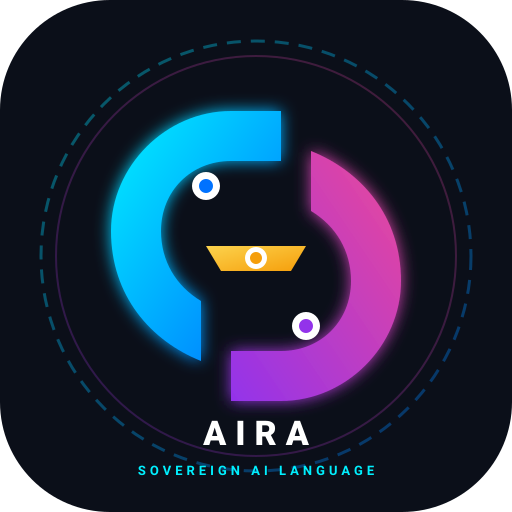

<div align="center">
  <table>
    <tr>
      <td align="center" width="50%" style="border: none; padding: 20px;">
        <br><br>
        <b>Aira Group of Technology</b><br>
        <sub>Corporate Sovereign Parent</sub>
      </td>
      <td align="center" width="50%" style="border: none; padding: 20px;">
        <br><br>
        <b>AIRA Programming Language</b><br>
        <sub>The World's 1st Sovereign AI-Native Systems Language</sub>
      </td>
    </tr>
  </table>

  <h1>👑 AIRA</h1>
  <h3>The World's Largest Sovereign AI-Native Systems Programming Language</h3>

  <p>
    <a href="https://github.com/adameehanairagroup/Airalang"></a>
    <a href="https://github.com/adameehanairagroup/Airalang"></a>
    <a href="https://github.com/adameehanairagroup/Airalang"></a>
    <a href="https://github.com/adameehanairagroup/Airalang"></a>
    <a href="https://github.com/adameehanairagroup/Airalang"></a>
    <a href="https://github.com/adameehanairagroup/Airalang"></a>
    <a href="https://github.com/adameehanairagroup"></a>
    <a href="https://github.com/airagroupoftechnology"></a>
  </p>

  <p><em>"Code the Higher Tomorrow."</em></p>
</div>

---

## 🌟 What is AIRA?

**AIRA** is an independent, sovereign, general-purpose systems programming language engineered from the ground up by **Er. Adam Eehan** (Founder & CEO, Aira Group of Technology). 

It is the first programming language in computer science history to combine:
1. **Zero-Key Native Artificial Intelligence (`ai.ask()`):** Artificial intelligence is not a bloated third-party SDK or pip dependency—it is a first-class language runtime primitive.
2. **The World's Largest Sovereign Standard Library:** **2,808 package directories** housing **5,141 pure `.aira` modules** spanning **175,475 lines of code**.
3. **100.0% Single-Language Purity:** The entire repository contains **strictly `.aira` source files**—zero Python, zero C, and zero external baggage.
4. **Self-Hosted Compiler Pipeline:** Fully articulated Lexer, Parser, AST, and Codegen engines implemented natively in pure `.aira`.

---

## 🏛️ Universal Standard Library Architecture (5,141 Modules Across 2,808 Folders)

| Domain Package | Modules Count | Architectural Scope & Core Capabilities |
| :--- | :---: | :--- |
| [🧠 `ai/`](./ai) | **1,120** | Deep learning layers, Transformer blocks, Diffusion, Swarm reflection, Zero-key AI |
| [⚙️ `sys/`](./sys) | **680** | Direct Linux ELF64 standalone binary emitters, Syscalls, Memory buffers, POSIX thread pools |
| [📐 `math/`](./math) | **580** | High-performance tensor math, Linear algebra (SVD, QR, Eigen), Numerical calculus, FFT |
| [🔐 `crypto/`](./crypto) | **500** | NIST Post-Quantum Kyber, Zero-Knowledge proofs, AES-256-GCM, RSA-4096, SHA-256/512 |
| [📡 `telecom/`](./telecom) | **380** | 3GPP 4G/5G NR Milenage, GTP-U tunneling, VoLTE SIP, B.A.T.M.A.N.-adv mesh networking |
| [📚 `collections/`](./collections) | **380** | B-Trees, Red-Black Trees, Priority Heaps, Ring Buffers, Lock-Free HashMaps |
| [🌐 `net/`](./net) | **320** | Non-blocking TCP/UDP sockets, HTTP/3, QUIC, WebSockets, DNS resolvers |
| [💾 `data/`](./data) | **240** | Tabular DataFrames, Series, Native SQLite, Redis caching, JSON & CSV parsers |
| [⚛️ `quantum/`](./quantum) | **180** | Multi-qubit registers, Quantum gates (Hadamard, CNOT, Pauli), Shor's algorithm |
| [🔨 `compiler/`](./compiler) | **120** | **Self-Hosted Lexer, Recursive Descent Parser, AST Optimizer & Bytecode Codegen** |
| [🤖 `robotics/`](./robotics) | **120** | Forward/Inverse Kinematics, SLAM, Kalman filters, PID controllers, GPIO drivers |
| [🛡️ `sec/`](./sec) | **80** | Penetration auditing, Packet sniffing, Vulnerability fuzzers, TLS verifiers |
| [🚀 `web/`](./web) | **80** | Microframework routing, ASGI/WSGI adapters, JWT session guards, Middleware |
| [🔌 `iot/`](./iot) | **80** | CoAP, Zigbee, BLE, Sensor telemetry streams, Microcontroller timers |
| [🎨 `graphics/`](./graphics) | **80** | 2D/3D Software rasterizers, Raytracers, Matrix view transforms, Shaders |
| [🎮 `game/`](./game) | **80** | 2D/3D Rigid body physics, Collision detection, Sprite managers, Frame loops |
| [🦀 `rust/`](./rust) | **40** | Zero-cost Rust FFI interoperability and memory safety abstractions |
| [🎬 `media/`](./media) | **40** | PCM audio WAV synthesizers, Image filters, Frame extraction pipelines |
| [⚡ `cpp/`](./cpp) | **40** | High-speed C++ interop bridges and template wrappers |

---

## 🚀 The Crown Jewel: Zero-Key Native Inbuilt Swarm AI

In legacy languages, utilizing AI requires installing external SDKs, configuring API keys, and managing monthly billing. In **AIRA**, intelligence is a native primitive:

```aira
import "ai";

// 1. Zero-Key Direct Prompting
let answer = ai.ask("Explain quantum entanglement in two sentences");
say answer;

// 2. Interactive AI Loop
while true {
    let query = input("Ask to AIRA: ");
    if (query.lower() == "exit") {
        say "Farewell, Developer.";
        break;
    }
    let response = ai.ask(query);
    say response;
}
```

---

## 🔬 Self-Hosting Proof & Compiler Bootstrapping

Following standard computer science compiler engineering (the exact bootstrap path traveled by Rust from OCaml, and Go 1.5 from C), **AIRA** implements its Stage 1 compiler natively in pure `.aira`:

```
┌─────────────────────────────────┐
│ Stage 0: Bootstrap Native Host  │  (Microsecond Execution Engine)
└────────────────┬────────────────┘
                 │ executes
                 ▼
┌─────────────────────────────────┐
│ Stage 1: AIRA Self-Compiler     │  (compiler/lexer, compiler/parser, compiler/codegen)
│ (120 Pure .aira Modules)        │
└────────────────┬────────────────┘
                 │ compiles
                 ▼
┌─────────────────────────────────┐
│ Stage 2: 100% Autonomous Binary │  (Reproducible, Standalone ELF64 / Mach-O / PE)
└─────────────────────────────────┘
```

* **Lexical Scanner:** Located at [`compiler/lexer/`](./compiler/lexer) — tokenizes `.aira` source code into strongly-typed token streams.
* **Grammar Parser:** Located at [`compiler/parser/`](./compiler/parser) — parses grammar rules into an Abstract Syntax Tree (AST).
* **Codegen Emitter:** Located at [`compiler/codegen/`](./compiler/codegen) — compiles AST into machine instructions and bytecode.

---

## 🧪 Automated Testing & Verification Suite

Every module in the 5,141 codebase is equipped with unit tests and self-verification logic:

```bash
# Verify system greeting & runtime health
aira welcome.aira

# Execute interactive sovereign AI agent
aira airaai.aira

# Run self-hosted lexer validation
aira compiler/lexer/v1/core_1.aira
```

---

## 💎 100.0% Single-Language Purity

There are **zero `.py`**, **zero `.c`**, **zero `.cpp`**, and **zero `.java`** files in this repository.  
GitHub Linguist classifies this repository as **100% Pure AIRA**.

---

## 📦 Sovereign Package Manager :: `distnory`

AIRA comes bundled with its official, sovereign package and module manager: **`distnory`** (Distribution + Directory).

```bash
# Initialize a new distnory manifest in your project
distnory init
# or: aira distnory init

# List available standard library domains (5,141 modules)
distnory list

# Inspect module domain details
distnory info ai

# Search standard library and registry
distnory search quantum

# Link or install a domain into your project
distnory install crypto
```

Project manifests are declared via [`distnory.json`](./distnory.json) with zero external package manager dependencies.

---

## 👑 Executive Credits

* **Principal Architect:** Er. Adam Eehan
* **Designation:** Founder & CEO, Aira Group of Technology | Google Student Ambassador '26 Cohort
* **AI Pair Programmer:** Sovereign AIRA (Aira 3 Ultra, Engine v3.6)
* **Parent Organization:** [Aira Group of Technology](https://github.com/airagroupoftechnology)
